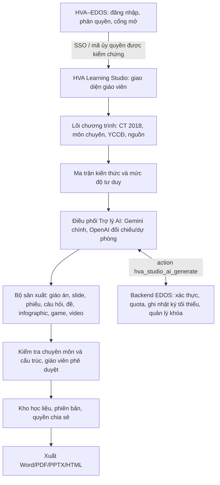

# HVA LEARNING STUDIO — KIẾN TRÚC TỔNG THỂ
**Bản thiết kế nền tảng — 05/11/2026**

**Khẩu hiệu:** Một nền tảng – Mọi môn học – Sáng tạo không giới hạn.

> Tài liệu mô tả **kiến trúc mục tiêu**, không phải báo cáo đã hoàn thiện phần mềm. Không gọi PASS nếu chưa có kiểm thử tạo/sửa/lưu/mở lại/xuất thực tế.

## 1. Sứ mệnh và triết lý
- Giáo viên chọn mục tiêu, kiểm tra và phê duyệt; AI hỗ trợ xây dựng sản phẩm.
- Một nội dung/chủ đề nguồn có thể tạo nhiều học liệu.
- Chương trình, yêu cầu cần đạt và nguồn được xác minh **trước** khi AI sinh nội dung.
- Lưu quan hệ truy vết từ mỗi sản phẩm / câu hỏi về yêu cầu cần đạt và phiên bản chương trình.
- Ứng dụng độc lập về mã và dữ liệu nghiệp vụ; dùng SSO/AI backend EDOS khi an toàn.

## 2. Sơ đồ kiến trúc

**Lưu ý:** Các mũi tên là cấu trúc mục tiêu. Hiện action Studio trong backend EDOS và SSO chưa được xác nhận triển khai.

## 3. Mười phân hệ
| Mã | Phân hệ | Đầu ra tối thiểu |
|---|---|---|
| H01 | Chương trình – Chủ đề – Yêu cầu cần đạt | Danh mục theo môn/lớp/chế độ, bản trích dẫn nguồn, ma trận kiến thức |
| H02 | Trợ lý AI – Chuyên gia | Quy trình yêu cầu, sinh bản nháp, chỉnh sửa và phản biện |
| H03 | Giáo án số | Kế hoạch bài dạy với mục tiêu, học liệu, hoạt động và đánh giá |
| H04 | Bài giảng số | PPTX/HTML trình chiếu, hình, biểu đồ, công thức |
| H05 | Phiếu học tập | Phiếu cá nhân, nhóm, phân hóa và hướng dẫn |
| H06 | Ngân hàng câu hỏi | Câu hỏi đa dạng, metadata yêu cầu cần đạt, lời giải, độ khó |
| H07 | Khảo thí và đề kiểm tra | Ma trận đề, bản đặc tả, đề, mã đề, đáp án, hướng dẫn chấm |
| H08 | Học liệu trực quan và tương tác | Infographic, sơ đồ tư duy, trò chơi, kịch bản/video |
| H09 | Chuyển đổi và kho học liệu | Nhập Word/PDF/PPTX, biên tập, tìm kiếm, phiên bản, xuất và chia sẻ |
| H10 | Quản trị – Thẩm định – Tích hợp | Quyền, nhật ký, kiểm thử AI, quota, SSO/EDOS |

## 4. Lõi chương trình — H01
Ba chế độ:
1. Phổ thông: CT GDPT 2018, văn bản sửa đổi bổ sung; đánh giá theo YCCĐ.
2. HSG thành phố: dùng nội dung/chủ đề CT GDPT 2018, nâng yêu cầu lên VDC và vận dụng rất cao (mức mở rộng phục vụ HSG, không phải mức chính thức của CT).
3. HSG quốc gia: CT GDPT và chương trình giáo dục nâng cao môn chuyên do Bộ ban hành; kiểm tra thêm quy định phạm vi thi tương ứng.

Mô hình dữ liệu chuẩn: `curriculum_version` → `subject` → `grade` → `strand` → `topic` → `learning_outcome` → `competency` → `cognitive_level` → `assessment_evidence`.
- Mỗi outcome có văn bản gốc, tên văn bản, mục/trang, ngày hiệu lực/phiên bản, trạng thái xác minh.
- Phân biệt nguyên văn chương trình với diễn giải của giáo viên/AI.
- Không có nguồn xác minh: hiện “Chưa có dữ liệu chương trình được xác minh”; không gán nhãn CT Bộ cho nội dung AI đề xuất.
- Mức tư duy phục vụ kiểm tra cần tuân thủ biểu mẫu áp dụng; không ép mỗi YCCĐ phải đủ mọi mức.

## 5. Ma trận đề và bản đặc tả — H07
Quy trình bất biến đối với đề Toán: **YCCĐ → Ma trận kiến thức → Ma trận đề → Bản đặc tả → Câu hỏi/đề → Đáp án/lời giải/thang điểm → Phản biện → Giáo viên duyệt → Xuất**.
- Đề kiểm tra định kỳ phổ thông: chọn mẫu áp dụng (ví dụ Phụ lục Công văn 7991/BGDĐT-GDTrH), thể hiện hình thức, mức độ, số câu, điểm, tỷ lệ; kiểm tra tổng khớp.
- Đề HSG: ma trận chuyên sâu riêng; không giả áp dụng mẫu đề định kỳ.
- Có mã định danh liên kết item ↔ dòng đặc tả ↔ outcome; không cho tạo đề chính thức nếu chưa có ma trận và đặc tả được duyệt.
- Phân biệt **ma trận kiến thức** (nguồn chuẩn) với **ma trận đề** (phân bổ câu hỏi/điểm).

## 6. Trợ lý AI — H02
Tên nghiệp vụ trên giao diện: “Trợ lý AI – Chuyên gia Giáo án / Khảo thí / HSG / Bài giảng / Học liệu...”.
- Gemini là AI chính; OpenAI là AI đối chiếu/dự phòng (chỉ khi backend được cấp quyền và kiểm thử).
- Google AI Studio là công cụ thử nghiệm dành cho quản trị, không phải AI thứ ba.
- AI nhận **gói ngữ cảnh có cấu trúc** gồm mục tiêu, outcome, nguồn, ma trận, dạng sản phẩm và ràng buộc sư phạm; từ chối tự tuyên bố nguồn khi thiếu chứng cứ.
- Kết quả luôn là `draft=true`, `reviewRequired=true`; nhận xét đối chiếu tách khỏi nội dung xuất.
- Không cho client chọn model, systemInstruction, quyền, API key hoặc endpoint.
- Hợp đồng đề xuất: action `hva_studio_ai_generate`; chỉ kích hoạt sau xác thực và kiểm thử.

## 7. Động cơ sản xuất và xuất file
- Mỗi sản phẩm có **mô hình tài liệu trung gian** (sections, blocks, tables, equations, figures, questions, answer keys, citations), tách nội dung khỏi giao diện.
- Chỉ trình xuất tương ứng được chuyển tài liệu sang DOCX, PDF, PPTX, HTML; kiểm thử bằng phần mềm đọc/tệp thực.
- Toán: hỗ trợ công thức và hình học có thể chỉnh sửa; câu hỏi phải có phép kiểm chứng lời giải độc lập khi khả thi.
- KHTN: sơ đồ/thí nghiệm và lưu ý an toàn; KHXH: bản đồ, thời gian, tư liệu; ngoại ngữ: ngữ âm/âm thanh; HĐTN: hoạt động, sản phẩm và tiêu chí đánh giá.
- Video/MP4 chỉ ghi hoàn thành khi có tệp thật; giai đoạn kịch bản không được gọi là chức năng tạo video.

## 8. Quy trình dữ liệu và quyền
Trạng thái học liệu: `nhap` → `AI_de_xuat` → `giao_vien_bien_tap` → `cho_tham_dinh` → `da_phe_duyet` → `da_xuat` → `chia_se`; sau chỉnh sửa phải phê duyệt lại.
- Kho cá nhân mặc định riêng tư; tổ chuyên môn chỉ xem/chia sẻ khi được cấp quyền.
- Bản lưu cục bộ trên trình duyệt là **thử nghiệm**, không phải kho đồng bộ chính thức.
- Lưu lịch sử các lần sửa, nguồn gốc nội dung, phản biện, người duyệt, thời điểm; bảo vệ bản quyền.
- Không gửi dữ liệu nhạy cảm của học sinh lên AI nếu chưa có chính sách và cơ sở xử lý phù hợp.

## 9. Bảo mật và kết nối EDOS
- Learning Studio chạy độc lập, EDOS có ô **STUDIO HỌC LIỆU SỐ**; chỉ chuyển phiên qua SSO/mã ủy quyền ngắn hạn được kiểm tra server-side.
- Không đưa token vào URL, GitHub Pages, localStorage hoặc postMessage không kiểm soát origin.
- Backend xác minh actor/nhân sự, quyền, quota và tần suất; khóa API giữ trong Script Properties hoặc nơi lưu bí mật phía server.
- Không sửa các dịch vụ EDOS đã PASS, không nạp trùng doGet/doPost/CONFIG/HVA_AI_SERVICE.
- Tách quota Studio và kiểm thử hồi quy EDOS trước khi đưa production.

## 10. Trình tự hoàn thiện và điều kiện PASS
**GĐ 0 — Nền tảng:** Sơ đồ kiến trúc, quy ước ID, dữ liệu trung gian, kiểm thử và quản lý phiên bản.
**GĐ 1 — H01:** Nạp nguồn chính thức từng môn/lớp; kiểm tra trích dẫn, ma trận kiến thức.
**GĐ 2 — H02 + H10 phần tích hợp:** Quy Pro hoàn thành action/SSO thử nghiệm, Quy 2 kết nối giao diện, test Gemini thật.
**GĐ 3 — H07 và H06:** Ma trận/đặc tả → câu hỏi → đề Toán thực → đáp án/thang điểm → kiểm chứng.
**GĐ 4 — H03/H05:** Giáo án, phiếu học tập có trình biên tập, xuất DOCX/PDF.
**GĐ 5 — H04/H08:** Bài giảng PPTX, trực quan, trò chơi/HTML, kịch bản/video.
**GĐ 6 — H09/H10:** Kho nhiều tài khoản, nhập/chuyển đổi, chia sẻ, bảo mật, kiểm toán.
**GĐ 7 — Tích hợp EDOS chính thức:** Hồi quy, hiệu năng, bảo mật, nghiệm thu và mở cổng.

**PASS phân hệ =** tạo thật + xem trước + sửa + lưu + mở lại + phê duyệt + xuất tệp mở được + xử lý lỗi + kiểm thử quyền (nếu có). **PASS AI/EDOS** yêu cầu gọi Backend thật, phân quyền/SSO thật, không lộ bí mật, hồi quy EDOS đạt.

## 11. Tình trạng tại thời điểm lập kiến trúc
- GitHub Pages đã có giao diện thử nghiệm; kho cục bộ, ma trận và bản đặc tả có mã nguồn, một số chức năng chưa qua kiểm thử trình duyệt/hồi quy.
- Adapter `studio-edos-adapter.js` đang chặn gọi AI theo mặc định.
- Cổng action Studio, SSO, Gemini thật, OpenAI dự phòng và kho nhiều người dùng **chưa PASS tích hợp**.

**Nguyên tắc bàn giao:** Chỉ hoàn thiện 1 phân hệ sau khi kiểm tra tác động đến phần đã PASS; không gắn nhãn thành công dựa trên giao diện mô phỏng.
